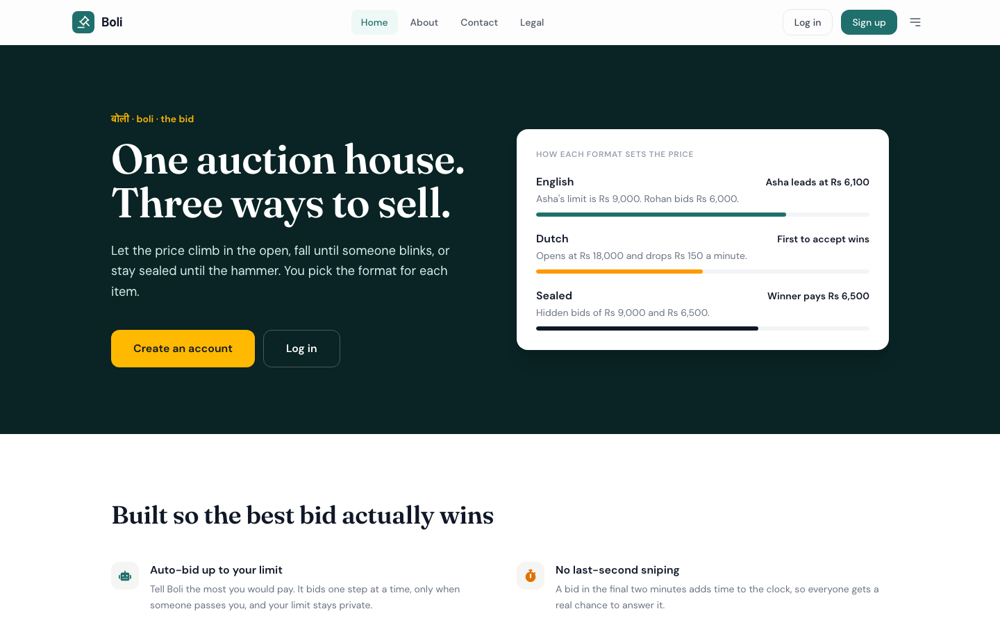
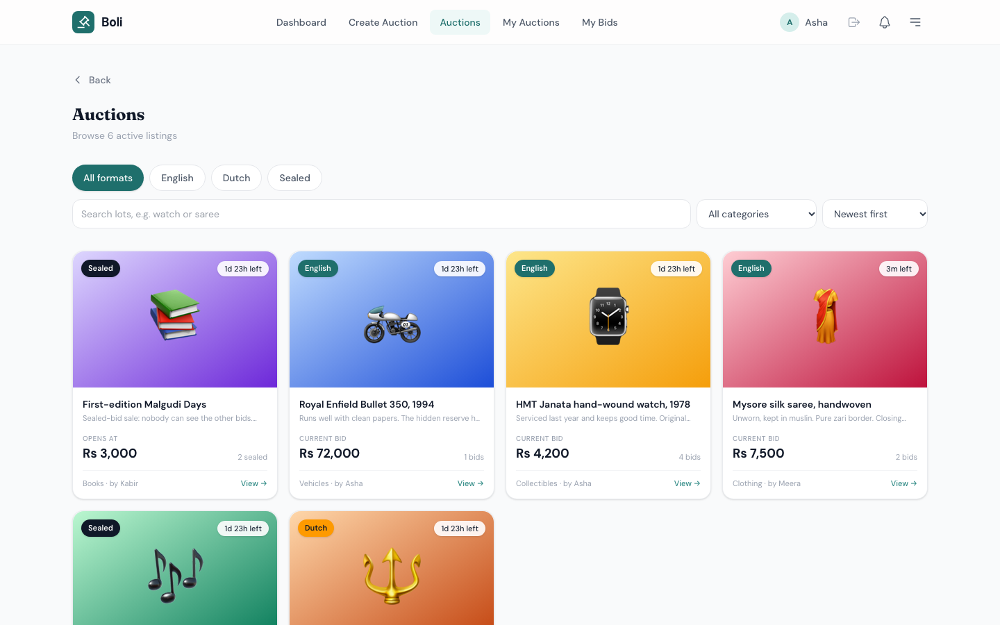
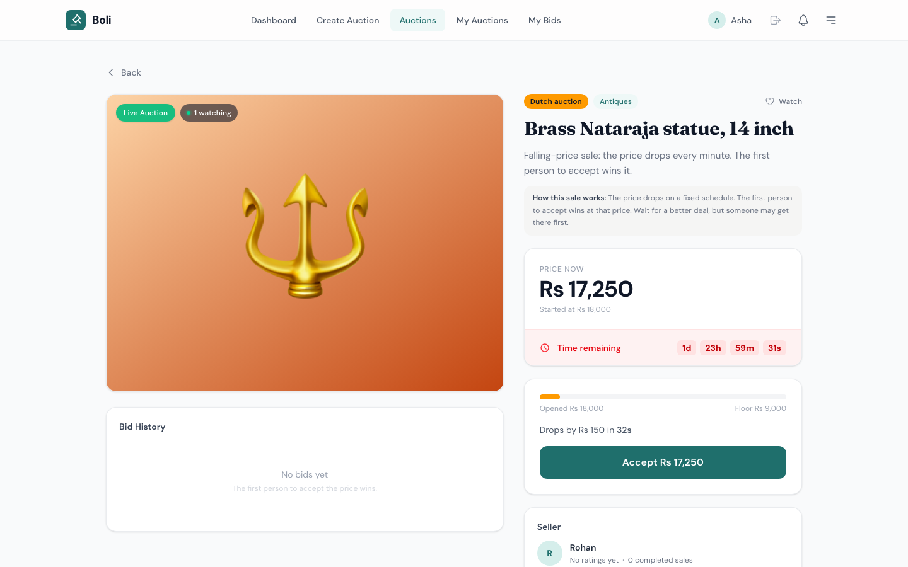

# Boli

**बोली: "the bid".** A real-time auction house with three auction formats, built on the MERN stack.

| Format | How the price works | Who wins |
|---|---|---|
| **English** | Rises through open bids, with optional auto-bid | Highest bidder when the clock ends |
| **Dutch** | Falls on a fixed schedule down to a floor | First person to accept |
| **Sealed (Vickrey)** | Hidden until the close | Highest bidder, who pays the second-highest amount |



## Screenshots

All screenshots come from the local demo (`npm run demo`), so every name and lot is sample data.

<table>
  <tr>
    <td width="50%" valign="top">
      
      <p><b>Browse auctions.</b> Filter by format and category, search, and sort. Every card shows its format and time left.</p>
    </td>
    <td width="50%" valign="top">
      
      <p><b>English auction.</b> Live price, countdown and price chart, with auto-bid up to a private limit and an optional Buy Now price.</p>
    </td>
  </tr>
  <tr>
    <td width="50%" valign="top">
      
      <p><b>Dutch auction.</b> The price falls on a schedule towards a floor, and the first person to accept wins.</p>
    </td>
    <td width="50%" valign="top">
      
      <p><b>Sealed auction.</b> Bids stay hidden until the close, and the winner pays the second-highest bid. The seller card shows a verified seller badge and rating.</p>
    </td>
  </tr>
  <tr>
    <td width="50%" valign="top">
      
      <p><b>After the sale.</b> The winner is announced, the seller can download the bid log as CSV, and buyer and seller rate each other.</p>
    </td>
    <td width="50%" valign="top">
      
      <p><b>Fair Play monitor (admin).</b> Flags possible shill bidding, such as a bidder who always bids on one seller and never wins, and exports a settlement report.</p>
    </td>
  </tr>
</table>

<p align="center">
  
  <br>
  <em>Works on phones too.</em>
</p>

## Features

- **Proxy bidding:** set a private limit and the server bids one step at a time for you.
- **Anti-sniping:** a bid in the last 2 minutes extends the auction (up to 15 times).
- **Hidden reserve and Buy Now:** sellers set a floor that bidders never see, or an instant-win price.
- **Automatic settlement:** a background worker closes auctions on time and picks the winner, without anyone having to open the page.
- **Fair Play monitor:** an admin report of shill-bidding signals: repeat underbidders, price pushers, shared IPs and machine-speed bidding.
- **Watchlist and live notifications:** outbid, won, sold and closing-soon alerts pushed over Socket.IO.
- **Scaled bid steps:** Rs 10 on small lots up to Rs 1,000 on large ones.
- **Server-side search:** full-text search, category and format filters, and sorting.
- **Price chart:** the price history of each lot.

## Run it locally

You need Node.js 20 or newer. MongoDB and API keys are not needed for the demo.

```bash
# Terminal 1: API with an in-memory database and sample data
cd server
npm install
npm run demo

# Terminal 2: web client
cd client
npm install
npm run dev
```

Open http://localhost:5173 and log in with password `demo1234` as `asha@demo.test`, `rohan@demo.test`, `meera@demo.test`, `kabir@demo.test`, `vikram@demo.test` or `admin@demo.test`. Open two browsers with different users to watch bids arrive live.

The first run downloads a MongoDB binary (around 100 MB). Demo data disappears when the server stops.

## Tests

```bash
cd server
npm test
```

The tests cover the pure auction rules and run the bidding service against a real in-memory MongoDB, including 20 simultaneous bids and two buyers racing to accept the same Dutch lot.

## Deploying

The client needs `VITE_API` set to the API URL. The server needs `MONGO_URL`, `JWT_SECRET` and `ORIGIN`, plus these optional variables: `CLOUDINARY_CLOUD_NAME`, `CLOUDINARY_API_KEY`, `CLOUDINARY_API_SECRET`, `RESEND_API_KEY`, `CONTACT_EMAIL` and `MAIL_FROM`. Without Cloudinary keys, new listings use a placeholder image. Without the three email settings, the contact form says it is unavailable.

Host the API on a long-running Node server (`npm start`), such as Render or Railway. Socket.IO and the settlement worker do not run on serverless hosts like Vercel.

## How it fits together

See [ARCHITECTURE.md](ARCHITECTURE.md).

## Credits and license

Boli started from the open-source [Auction Management System](https://github.com/unnati-joshi/Auction-Management-System), which carries an MIT license by Avnish Kumar. The login, profile, legal pages and base app structure come from that project. The original copyright notice is kept in [LICENSE](LICENSE), as the license requires.
