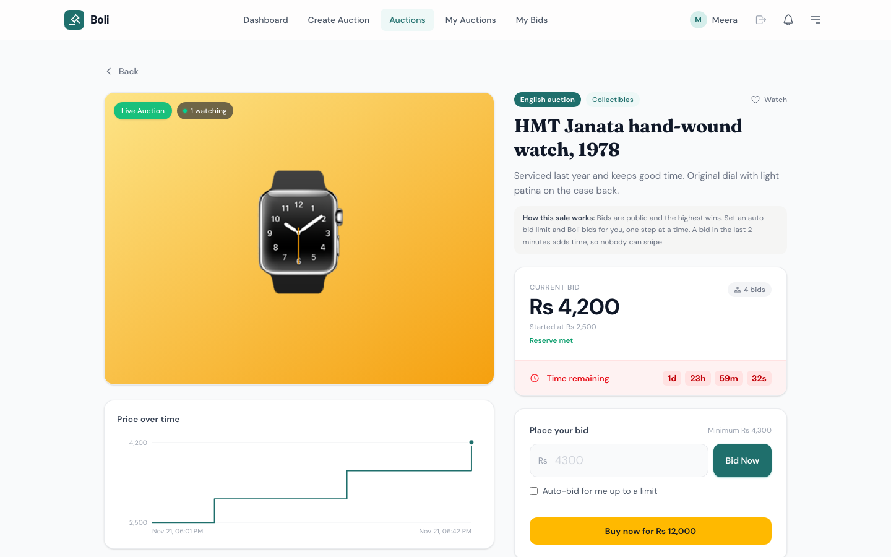
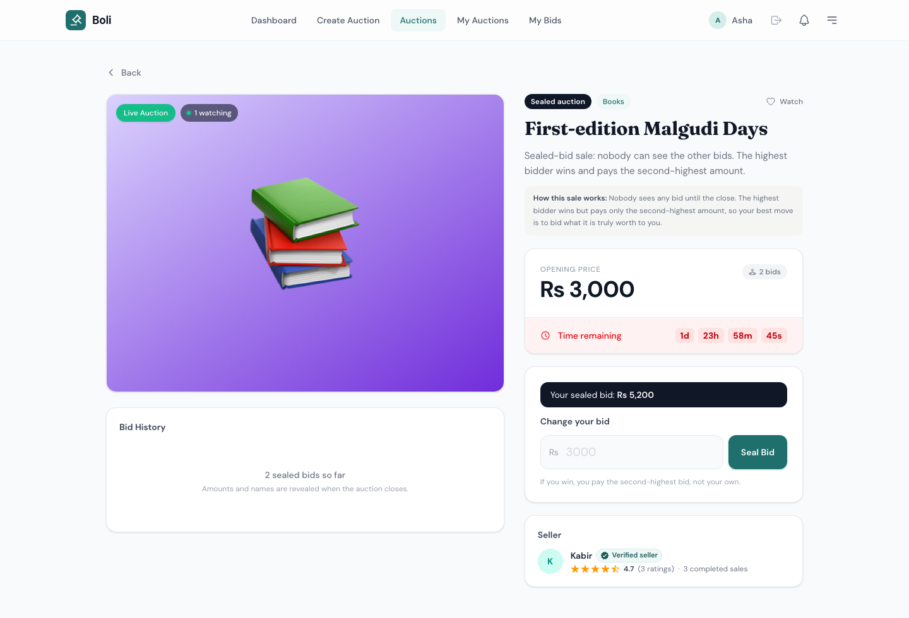
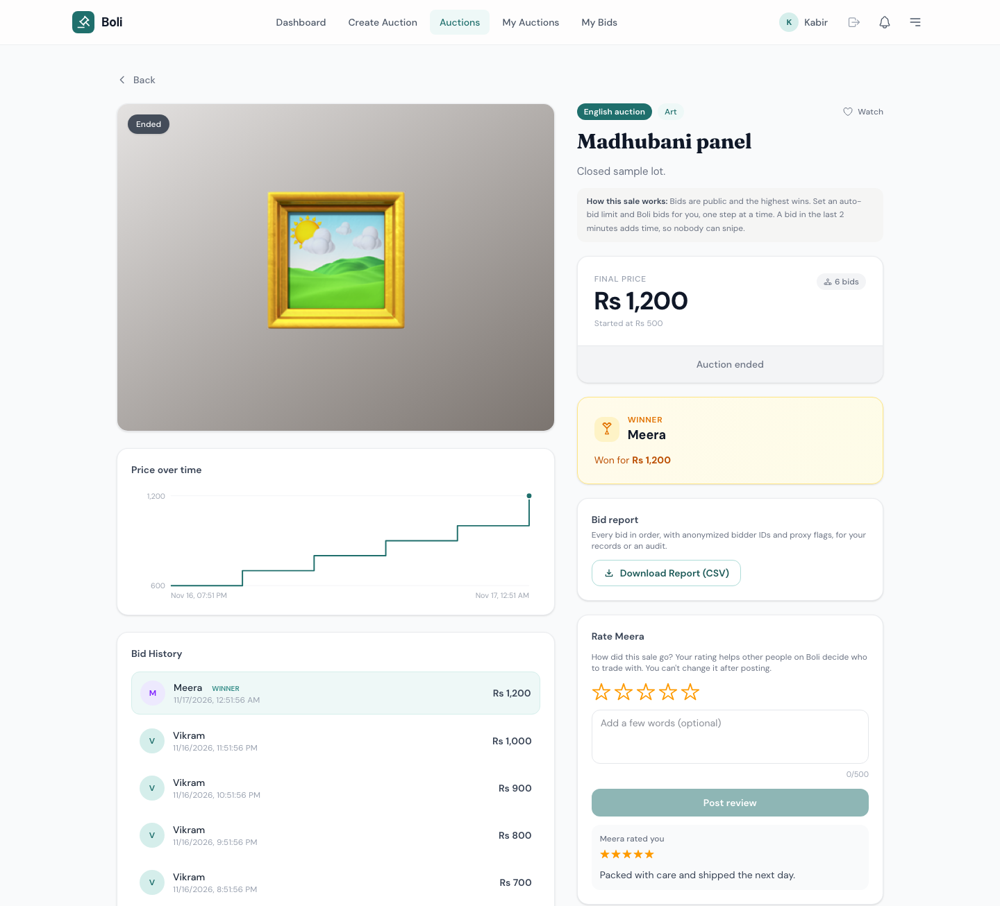
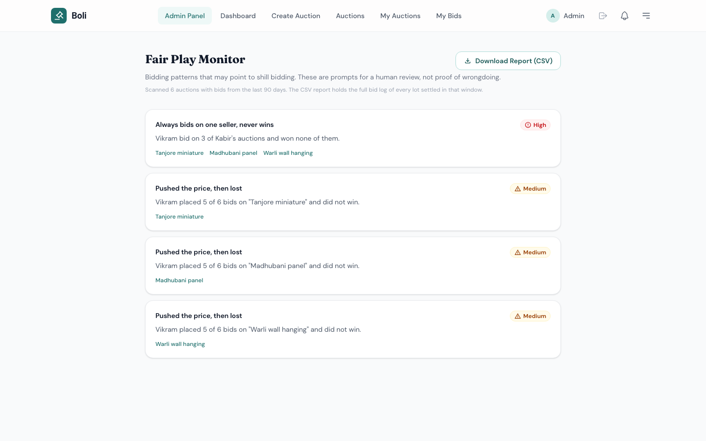
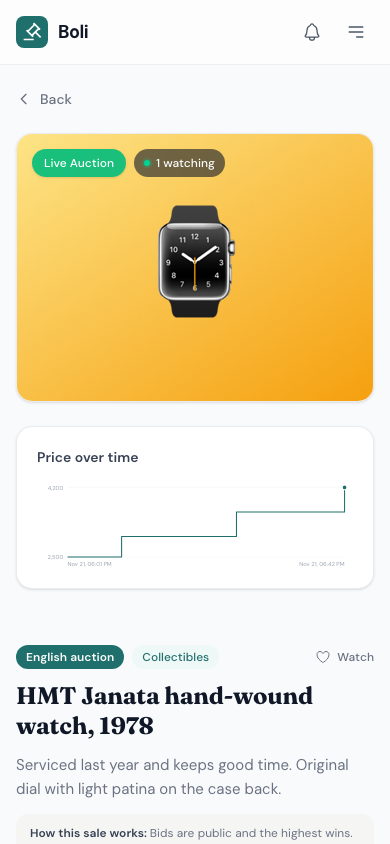

# Boli

**बोली: "the bid".** A real-time auction house with three auction formats, built on the MERN stack.

| Format | How the price works | Who wins |
|---|---|---|
| **English** | Rises through open bids, with optional auto-bid | Highest bidder when the clock ends |
| **Dutch** | Falls on a fixed schedule down to a floor | First person to accept |
| **Sealed (Vickrey)** | Hidden until the close | Highest bidder, who pays the second-highest amount |


## Screenshots

All screenshots come from the local demo (`npm run demo`), so every name and lot is sample data.

<table>
  <tr>
    <td width="50%" valign="top">
      
      <p><b>Browse auctions.</b> Filter by format and category, search, and sort. Every card shows its format and time left.</p>
    </td>
    <td width="50%" valign="top">
      
      <p><b>English auction.</b> Live price, countdown and price chart, with auto-bid up to a private limit and an optional Buy Now price.</p>
    </td>
  </tr>
  <tr>
    <td width="50%" valign="top">
      
      <p><b>Dutch auction.</b> The price falls on a schedule towards a floor, and the first person to accept wins.</p>
    </td>
    <td width="50%" valign="top">
      
      <p><b>Sealed auction.</b> Bids stay hidden until the close, and the winner pays the second-highest bid. The seller card shows a verified seller badge and rating.</p>
    </td>
  </tr>
  <tr>
    <td width="50%" valign="top">
      
      <p><b>After the sale.</b> The winner is announced, the seller can download the bid log as CSV, and buyer and seller rate each other.</p>
    </td>
    <td width="50%" valign="top">
      
      <p><b>Fair Play monitor (admin).</b> Flags possible shill bidding, such as a bidder who always bids on one seller and never wins, and exports a settlement report.</p>
    </td>
  </tr>
</table>

<p align="center">
  
  <br>
  <em>Works on phones too.</em>
</p>

## Features

- **Proxy bidding:** set a private limit and the server bids one step at a time for you.
- **Anti-sniping:** a bid in the last 2 minutes extends the auction (up to 15 times).
- **Hidden reserve and Buy Now:** sellers set a floor that bidders never see, or an instant-win price.
- **Automatic settlement:** a background worker closes auctions on time and picks the winner, without anyone having to open the page.
- **Fair Play monitor:** an admin report of shill-bidding signals: repeat underbidders, price pushers, shared IPs and machine-speed bidding.
- **Watchlist and live notifications:** outbid, won, sold and closing-soon alerts pushed over Socket.IO.
- **Scaled bid steps:** Rs 10 on small lots up to Rs 1,000 on large ones.
- **Server-side search:** full-text search, category and format filters, and sorting.
- **Price chart:** the price history of each lot.
- **Bid reports (CSV):** sellers and admins download the full bid log of a settled lot (timestamps, anonymized bidder IDs, proxy flags and amounts), and admins download every lot settled in the Fair Play window from the monitor page.
- **Ratings and verified sellers:** after a sale settles, the winner rates the seller and the seller rates the winner (1 to 5 stars, optional review). Lot pages show the seller's average buyer rating and completed sales, and sellers with 3 or more sales and an average of 4 stars or higher get a verified badge.

## Run it locally

You need Node.js 20 or newer. MongoDB and API keys are not needed for the demo.

```bash
# Terminal 1: API with an in-memory database and sample data
cd server
npm install
npm run demo

# Terminal 2: web client
cd client
npm install
npm run dev
```

Open http://localhost:5173 and log in with password `demo1234` as `asha@demo.test`, `rohan@demo.test`, `meera@demo.test`, `kabir@demo.test`, `vikram@demo.test` or `admin@demo.test`. Open two browsers with different users to watch bids arrive live.

The first run downloads a MongoDB binary (around 100 MB). Demo data disappears when the server stops.

## Tests

```bash
cd server
npm test
```

The tests cover the pure auction rules and run the bidding service against a real in-memory MongoDB, including 20 simultaneous bids and two buyers racing to accept the same Dutch lot.

## Deploying

Boli uses a **split-stack architecture**: the Express/Socket.IO API and background settlement worker run on a long-running Node host (**Render**), while the Vite React client is deployed as a static SPA (**Vercel**) backed by **MongoDB Atlas**.

### Live Deployment

- **Frontend (Vercel):** https://auction-management-system-sigma.vercel.app
- **Backend API (Render):** https://boli-g9fd.onrender.com

  To view the admin functions: 
```bash
Email:admin@admin.com
Password: admin1234
```

### Environment Variables

#### Backend (`server/`) — Render

| Variable | Required | Description |
|---|---|---|
| `MONGO_URL` / `MONGO_URI` | Yes | MongoDB Atlas connection string |
| `JWT_SECRET` | Yes | Secret key used to sign session JWT tokens |
| `ORIGIN` | Yes | Single plain frontend URL for CORS (e.g., `https://auction-management-system-sigma.vercel.app`, no trailing slash or Markdown formatting) |
| `CLOUDINARY_CLOUD_NAME` | No | Cloudinary cloud name for listing image uploads |
| `CLOUDINARY_API_KEY` | No | Cloudinary API key |
| `CLOUDINARY_API_SECRET` | No | Cloudinary API secret (falls back to a placeholder image if omitted) |
| `RESEND_API_KEY` | No | Resend API key for contact form emails |
| `CONTACT_EMAIL` | No | Destination inbox for contact form submissions |
| `MAIL_FROM` | No | Verified sender address (contact form reports unavailable if email vars are omitted) |
| `GOOGLE_CLIENT_ID` | No | OAuth client ID from Google Cloud. When set, the login and signup pages show **Continue with Google**; when unset, the button is hidden |
| `GOOGLE_CLIENT_SECRET` | No | OAuth client secret from the same Google Cloud client. Optional: sign-in verifies Google ID tokens, which needs only the client ID |

#### Frontend (`client/`) — Vercel

| Variable | Required | Type | Description |
|---|---|---|---|
| `VITE_API` | Yes | Config | Plain URL of the deployed Render backend (e.g., `https://boli-g9fd.onrender.com`, no trailing slash) |

### Step-by-Step Deployment Guide

1. **Database (MongoDB Atlas):**
   - Create a free M0 cluster, add a database user, and allow network access (`0.0.0.0/0`) so Render can connect.
   - Copy the connection string for `MONGO_URL` / `MONGO_URI`.

2. **Backend API (Render Web Service):**
   - Create a new **Web Service** connected to this GitHub repository.
   - Set **Root Directory** to `server`, **Build Command** to `npm install`, and **Start Command** to `npm start`.
   - Add `MONGO_URL`, `MONGO_URI`, `JWT_SECRET`, and `ORIGIN` (set to your exact Vercel domain, e.g., `https://auction-management-system-sigma.vercel.app`).
   - Note: Visiting the root backend URL (`/`) returns `Cannot GET /` because Express only exposes API routes (`/auth/...`, `/auction/...`, `/user`, etc.). Socket.IO and the automatic settlement worker require this persistent Node runtime and will not run on serverless hosts.

3. **Frontend Client (Vercel):**
   - Import the repository on Vercel (project names must be lowercase) and set **Root Directory** to `client` with **Framework Preset** set to `Vite`.
   - Add `VITE_API` as a **Config** environment variable pointing to your Render URL (`https://boli-g9fd.onrender.com`), then trigger a **Redeploy** with build cache disabled so Vite embeds the API URL.
   - Ensure `client/vercel.json` is present so client-side routes (`/login`, `/signup`, `/dashboard`, `/auction/:id`) do not return `404` on page refresh:
     ```json
     {
       "rewrites": [{ "source": "/(.*)", "destination": "/index.html" }]
     }
     ```
   - Production databases start empty (`demo1234` accounts exist only in local `npm run demo` mode). Register a fresh account via `/signup` on the live site, and optionally update that user's `role` to `"admin"` in MongoDB Atlas Data Explorer to access the **Fair Play** monitor.

4. **Google sign-in (optional):**
   - In [Google Cloud Console](https://console.cloud.google.com/apis/credentials), create an **OAuth client ID** of type **Web application**.
   - Under **Authorized JavaScript origins**, add the frontend URL (e.g., `https://auction-management-system-sigma.vercel.app`) and `http://localhost:5173` for local testing. No redirect URI is needed, because sign-in uses a Google popup.
   - Add `GOOGLE_CLIENT_ID` (and optionally `GOOGLE_CLIENT_SECRET`) to the Render backend and redeploy. The client reads the ID from the API, so Vercel needs no change.
   - Signing in with Google links to an existing account with the same email, as long as Google has verified that email, so existing users keep their role, bids and listings. People who sign up with Google can set a password later in **Profile** if they also want to log in with their email.

## How it fits together

See [ARCHITECTURE.md](ARCHITECTURE.md).

## Credits and license
The original copyright notice is kept in [LICENSE](LICENSE), as the license requires.
